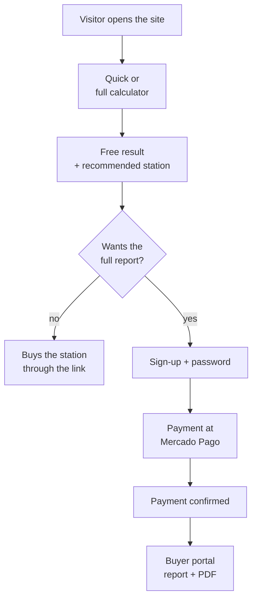

# User journey

This page describes EnergCalc from the user's point of view. There are three roles: **visitor**, **buyer** and **owner**.

## 1. Calculate

There are two ways to calculate, and both use the same engine.

**Quick calculator (on the home page).** The person taps the appliances that must stay on — fridge, router, lights and phone are preselected — adjusts quantities with **+** and **−**, and picks the blackout length on a slider (from 1 hour to 5 days). Results appear instantly: energy, battery to buy, power, starting surge, minimum inverter, solar panels and the power station that fits.

**Full calculator (8 steps).** For people who want to detail every appliance:

| Step | What the person enters | Why it matters |
|---|---|---|
| 1. Location | Region, outlet voltage (127/220 V) and frequency | Buying equipment for the wrong voltage is the most common mistake; the region sets the available sunlight. |
| 2. Goal | Blackout, cabin, camping, RV… | Changes priorities: portability, autonomy, expansion. |
| 3. Solution type | Ready-made station, battery + inverter, solar, or "not sure" | With "not sure", EnergCalc compares everything. |
| 4. Appliances | Power, hours per day, duty cycle, measured consumption | A fridge's real consumption is much lower than its label wattage. |
| 5. Simultaneity | What runs at the same time | Sets the inverter size and the starting surge. |
| 6. Duration | From 1 hour to 5 days, or custom | Sets the battery size. |
| 7. Recharging | Panels, grid, generator, portable or fixed | Without recharging, every extra hour needs more battery. |
| 8. Preferences | Battery chemistry, budget, brands, expansion | Preferences never override safety. |

Every step has a **"Why do we ask?"** button with a short explanation.

## 2. See the free result

Without signing up, the result shows:

- **Energy needed** (kWh) for the blackout period.
- **Simultaneous power** and **starting surge** (W).
- A **chart** of each appliance's energy — it shows which one dominates.
- Relevant **alerts** (for example, medical equipment or a very high load).
- **One recommended ready-made station**, with a store link. If no station covers the whole period, the closest one appears with the number of hours it can run.

## 3. Buy the full report

Below the result is the full-report offer. The person:

1. Enters **name, email, WhatsApp (optional)** and **creates a password** for the portal.
2. Accepts the communication terms (data-protection consent).
3. Is taken to **Mercado Pago** (Pix instant transfer or card).

The welcome offer is described in [Purchase and access](#en-purchase).

## 4. Use the portal

After paying, the person **confirms their email** (a link is sent automatically) and signs in to **My portal** with email and password. There they can:

- see each purchase's status ("Unlocked" or "Waiting for confirmation");
- open the **report on screen**;
- **download the PDF**;
- **review** the purchase (stars and a comment), which is published only after moderation.

## 5. What the owner sees

The owner follows everything in the [Dashboard](#en-dashboard): traffic, funnel, traffic sources, sign-ups, purchases, payments and reviews.
