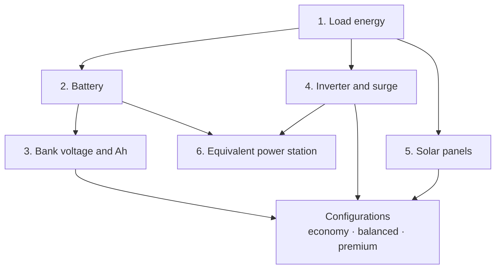

# Calculation engine

The engine turns "what must stay on" into engineering numbers. It is a standalone module: it does not depend on the screen, the database or the internet, and it runs **identically** in the browser (for the instant preview) and on the server (for the official calculation behind the report).

## Two concepts everything else builds on

**Power (W)** is how hard an appliance draws energy *right now*. It sizes the **inverter**.
**Energy (Wh or kWh)** is how much the appliance uses *over time*. It sizes the **battery**.

> **The water-tank analogy.** The battery is the size of the tank (kWh). The inverter is the width of the pipe (W). The solar panel is the rain that refills the tank (Wp). Get any of the three wrong and the house goes dark.

## The six calculation steps

### 1. Load energy

For each appliance:

`Energy (Wh) = Power (W) × Quantity × Hours of use × Duty cycle`

- The **duty cycle** exists because compressors (fridges, freezers) switch on and off. A 150 W fridge doesn't draw 150 W all day; on average it runs about 40% of the time.
- If the person enters **measured consumption** (from the energy label or a meter), that value **replaces** the estimate — and the duty cycle is not applied again.
- **Standby** consumption is added for the hours the appliance isn't in use.
- **Blackouts shorter than 24 h:** the engine conservatively assumes daily use happens during the blackout. **24 h or more:** daily consumption × number of days.

### 2. Battery

No battery should be drained to zero, and every conversion loses energy. That is why the battery you buy is always bigger than the consumption:

`Nominal battery = (AC energy ÷ inverter efficiency + DC energy ÷ DC efficiency) ÷ depth of discharge × (1 + aging reserve)`

| Factor | Default | Why |
|---|---|---|
| Inverter efficiency | 90% | Converting DC to AC loses energy as heat. |
| DC path efficiency | 95% | DC loads (12 V, USB) go through simpler converters. |
| Depth of discharge — LiFePO4 | 90% | Lithium iron phosphate tolerates deep discharge. |
| Depth of discharge — lead-acid | 50% | Deep discharges sharply shorten its life. |
| Aging reserve | +10% | Batteries lose capacity over the years. |

The AC and DC paths are calculated **separately**, so no loss is counted twice.

### 3. Bank voltage and amp-hours

`Ah = Wh ÷ Voltage`

Larger banks move up in voltage (12 → 24 → 48 V) to reduce current — which allows thinner cables and less heat. The rule: the lowest voltage that keeps continuous current at or below 150 A, with 12 V limited to about 2.5 kWh and 24 V to about 6 kWh.

For each battery model the engine also checks the **manufacturer's limits**: how many in series and in parallel, and the continuous and peak current allowed by the **BMS** (the battery's protection circuit).

### 4. Inverter and starting surge

Adding up watts is not enough. The engine evaluates:

- **Simultaneous power** — what runs together. Appliances marked "doesn't run together" (a microwave, for example) are evaluated on their own, added to the loads that never switch off.
- **Apparent power (VA)** — accounts for motors' power factor (0.8 when the manufacturer doesn't state it).
- **A 25% margin** — an inverter shouldn't run at its limit.
- **Starting surge** — motors draw 3 to 7 times their power for an instant when starting. The surge used is the running load plus the largest single start.
- **Waveform** — always **pure sine**, required by motors and sensitive electronics.
- **Output voltage and frequency** — must match the home's.

### 5. Solar panels

`Panel power (Wp) = Daily energy drawn from the battery ÷ (Peak sun hours × Performance ratio × Site factor × Charge efficiency)`

| Factor | Default | Meaning |
|---|---|---|
| Peak sun hours (PSH) | Per region, annual average and worst month | How many hours of "full" sun the location gets. A **regional estimate**, not a measurement at the address. |
| Performance ratio | 75% | Heat, dirt, cabling and the controller. |
| Site factor | 100% | Orientation and shading (adjustable). |
| Charge efficiency | 95% (LiFePO4) | Loss when storing energy in the battery. |

Before suggesting any panel arrangement, the engine validates the **charge controller (MPPT)**:

- the **cold-weather voltage** (Voc corrected for the region's minimum temperature) must not exceed the controller's limit;
- the **hot-weather voltage** (Vmp corrected for a hot cell) must be high enough to charge the battery;
- **short-circuit current**, **battery voltage**, **chemistry** and **maximum power** must all be within what the controller accepts.

An arrangement with any **incompatible** rule is never suggested.

### 6. Equivalent power station

For power stations, the engine **never** assumes the full nominal capacity reaches the outlet. It uses the manufacturer's documented usable energy or, if that's missing, an **85%** estimate, labeled as an estimate. It then checks continuous power (with 10% headroom), surge, voltage, frequency and solar input. If the station accepts extra batteries, the engine works out how many are needed.

## Compatibility result

Every check returns one of four states:

| State | Meaning |
|---|---|
| **Compatible** | Meets the requirement with the available data. |
| **Conditionally compatible** | Meets it, with a caveat (e.g., buy the 127 V version). |
| **Incompatible** | Doesn't meet it. The configuration is discarded. |
| **Insufficient data** | A manufacturer figure is missing. **Never** treated as compatible. |

A configuration's state is the **worst** of all its checks.

## Three configurations and recommendations

For each project the engine builds:

| Configuration | Characteristics |
|---|---|
| **Economy** | Lowest cost among the safe options. |
| **Balanced** | +10% capacity and a good cost/expansion balance. |
| **Premium** | +25% capacity, one inverter size up and panels sized for the **worst month**. |

It also produces **recommendations** — for example, reducing use of the appliance that dominates consumption, or adding panels for a long blackout. Each recommendation is **recalculated from scratch** and shows the current configuration, the proposal, the cost difference, the performance difference and the limitations.

## What every calculation records

Every result includes the inputs, the values, the **assumptions** (and whether each came from the user, a datasheet or an estimate), alerts, the **engine version** and the **regional rules version**. That makes any report reproducible and auditable.

See it all applied to a real case in the [Worked example](#en-worked-example).
