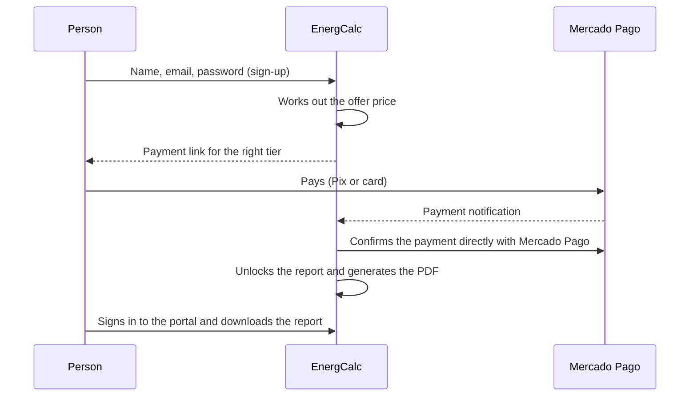

# Purchase and access

## Welcome offer

For people getting to know EnergCalc, we set aside a **special welcome offer** on the full report. The discount appears with the result, with the final price already worked out. The price charged is always the one on screen at the time of purchase.

## Payment

- Payment happens **at Mercado Pago**. EnergCalc never sees card data.
- The report is unlocked only after the server **confirms the payment directly with Mercado Pago** — never because the browser "said" it paid.
- If a payment arrives that can't be matched automatically to a sign-up (for example, paid with a different email), it is set aside for the owner to match manually.
- There is a **7-day right of withdrawal**, as required by Brazilian consumer law.

## The buyer portal

- **Email and password account**, created at checkout (minimum 8 characters).
- **Email confirmation required** before the first sign-in. This ensures only the owner of the purchase email can open the report.
- **Forgot password:** a link is emailed to create a new one.
- In the portal: purchase list, on-screen report, PDF and purchase review.

## Reviews

Only people with a confirmed purchase can leave a review. Reviews are published after moderation, with the first name only and a **"Verified purchase"** badge. EnergCalc doesn't publish reviews that don't come from real purchases.
