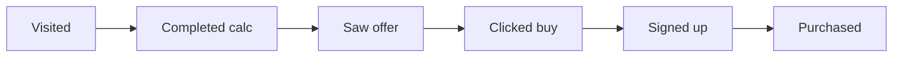

# Owner dashboard

The dashboard shows how the site is being used and how it sells. Access is restricted: admin permission is checked in the database, not just by hiding the screen.

## Tabs

| Tab | What it's for |
|---|---|
| **Overview** | Indicators, funnel, daily chart, sources, pages, clicks per station, devices. |
| **Tracking** | Each visit's journey, event by event. |
| **Sign-ups** | Who signed up, source, purchase status, WhatsApp contact and spreadsheet export. |
| **Purchases** | Paid orders, amounts, offer tier, refunds. |
| **Unmatched payments** | Payments that need to be matched to a sign-up by hand. |
| **Reviews** | Moderation and the initial's color for each review. |
| **Payment links** | One Mercado Pago link per price tier. |
| **Catalog** | Price with source and date, verification status and referral link for each product. |

## Metrics dictionary

| Metric | How it is counted |
|---|---|
| **Visitors** | Unique anonymous identifiers that opened at least one page in the period. |
| **Sessions** | Visits; a session ends after 30 minutes of inactivity. |
| **Page views** | Total pages opened. |
| **Used the calculator** | Sessions that interacted with the quick calculator. |
| **Completed calculations** | Results generated (quick or full). |
| **Affiliate clicks** | Clicks on station purchase links. |
| **Saw the offer** | Sessions in which the report offer appeared on screen. |
| **Clicked buy** | Sessions that opened the purchase form. |
| **Sign-ups** | People who submitted name and email at checkout. |
| **Purchases** | Orders with confirmed payment in the period. |
| **Revenue** | Sum of confirmed orders. |
| **Conversion** | Purchases ÷ visitors. |
| **Average ticket** | Revenue ÷ purchases. |

## The funnel

Each step shows the number of sessions and the percentage relative to the previous step — the biggest drop is where improvement pays off first.

## Traffic sources

The source comes from the link's `utm_source` parameter (for example, `?utm_source=instagram&utm_medium=bio`) or, if absent, from the referring site. With neither, it shows as **direct**. The **first-touch** source stays attached to the person, so a purchase made days later is still credited to the right channel.
