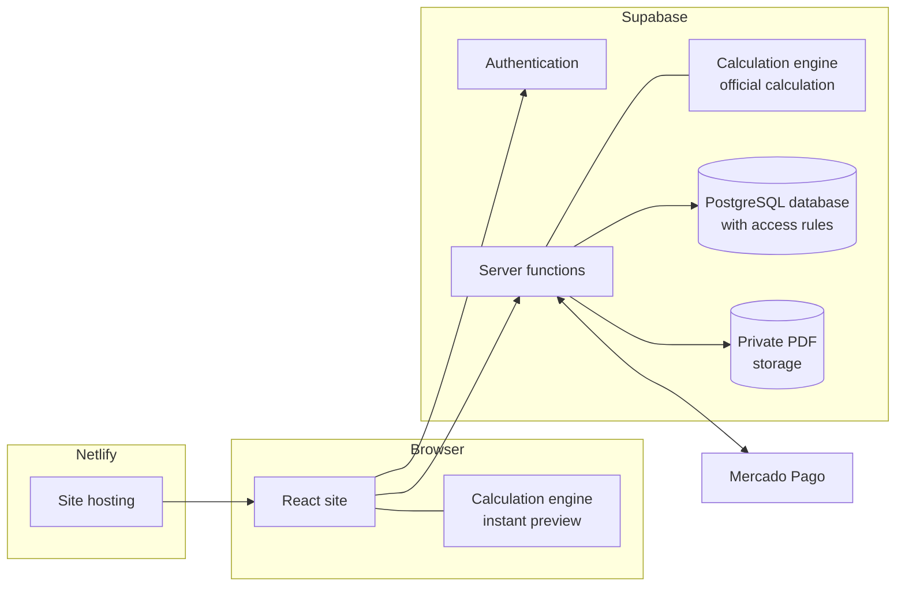

# Architecture

EnergCalc is a web application with three layers: the **site** (in the browser), the **server** (database and functions) and the **payment provider**.

## Components

| Component | Technology | Responsibility |
|---|---|---|
| Site | React, TypeScript, Vite, Tailwind CSS | Screens, calculators, portal and dashboard. |
| Hosting | Netlify | Publishing the site and preview builds. |
| Calculation engine | Standalone TypeScript package | All engineering math. |
| Database | PostgreSQL (Supabase) | Projects, calculations, orders, catalog, metrics. |
| Authentication | Supabase Auth | Anonymous sessions for the calculator; email and password for the portal. |
| Server functions | Supabase Edge Functions | Official calculation, pricing, payment, report, administration. |
| Storage | Supabase Storage | Private PDFs. |
| Payment | Mercado Pago | Pix instant transfer and cards. |

## Design decisions

**One engine, two places.** The same calculation code runs in the browser (instant feedback while you tap buttons) and on the server (the official result that goes into the report). The preview and the report therefore never disagree.

**One source for every rule.** The offer pricing, the result texts and the report model each live in a single place, used by both the screen and the server.

**The browser never decides anything worth money.** Price, report unlocking and the official calculation are always decided on the server.

**Screen and PDF from the same model.** The report is assembled once as structured data and then rendered two ways: HTML in the portal and PDF on the server.

**No sign-up to calculate.** You calculate with an anonymous session; your email-and-password account is created only when you buy.

## Server functions

| Function | What it does |
|---|---|
| Official calculation | Runs the engine with the database catalog and stores the immutable result. |
| Offer clock | Returns the person's offer time and activates the last chance when it applies. |
| Checkout start | Records the sign-up, works out the price and returns the payment link. |
| Payment notification | Receives Mercado Pago's notice, confirms the payment and unlocks the report. |
| Report | Delivers the report for the screen and a temporary link to the PDF. |
| Orders (admin) | Manual unlock, refund and payment matching. |
| Catalog (admin) | Sourced prices, verification and referral links. |

## Languages and regions

All interface text lives in translation files (Portuguese and English). Country-specific technical rules live in **versioned jurisdiction profiles**: today, Brazil (60 Hz, 127 V or 220 V outlets, five climate regions). The structure already supports other countries, which will only be enabled after a professional review of local rules.
