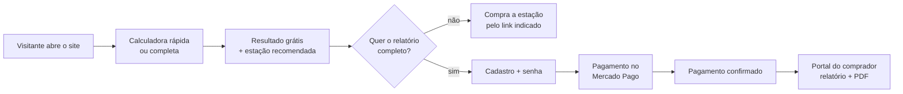

# Jornada do usuário

Esta página descreve o EnergCalc do ponto de vista de quem usa. Existem três perfis: **visitante**, **comprador** e **proprietário**.

## 1. Calcular

Há duas formas de calcular, e as duas usam o mesmo motor.

**Calculadora rápida (na página inicial).** A pessoa toca nos aparelhos que precisam ficar ligados — geladeira, roteador, lâmpadas e celular já vêm marcados — ajusta a quantidade com **+** e **−** e escolhe a duração do apagão num controle deslizante (de 1 hora a 5 dias). O resultado aparece na hora: energia, bateria a comprar, potência, pico de partida, inversor mínimo, painéis solares e a estação que atende.

**Calculadora completa (8 etapas).** Para quem quer detalhar cada aparelho:

| Etapa | O que a pessoa informa | Por que importa |
|---|---|---|
| 1. Local | Região, tensão da tomada (127/220 V) e frequência | Equipamento na tensão errada é o erro mais comum; a região define o sol disponível. |
| 2. Objetivo | Apagão, cabana, camping, motorhome… | Muda prioridades: portabilidade, autonomia, expansão. |
| 3. Tipo de solução | Estação pronta, bateria + inversor, solar, ou "não sei" | No "não sei", o EnergCalc compara tudo. |
| 4. Aparelhos | Potência, horas por dia, ciclo, consumo medido | O consumo real de uma geladeira é bem menor que a potência da etiqueta. |
| 5. Simultaneidade | O que liga ao mesmo tempo | Define o tamanho do inversor e o pico de partida. |
| 6. Duração | De 1 hora a 5 dias, ou outra | Define o tamanho da bateria. |
| 7. Recarga | Painéis, rede, gerador, portátil ou fixo | Sem recarga, cada hora extra exige mais bateria. |
| 8. Preferências | Química da bateria, orçamento, marcas, expansão | Preferências nunca passam por cima da segurança. |

Cada etapa tem um botão **"Por que perguntamos isso?"** com uma explicação curta.

## 2. Ver o resultado grátis

O resultado mostra, sem cadastro:

- **Energia necessária** (kWh) no período do apagão.
- **Potência simultânea** e **pico de partida** (W).
- Um **gráfico** com a energia de cada aparelho — mostra qual deles domina o consumo.
- **Alertas** relevantes (por exemplo, equipamento médico ou carga muito alta).
- **Uma estação pronta recomendada**, com link para o Mercado Livre. Se nenhuma estação cobre toda a autonomia, aparece a mais próxima e quantas horas ela sustenta.

## 3. Comprar o relatório completo

Abaixo do resultado fica a oferta do relatório completo. A pessoa:

1. Informa **nome, e-mail, WhatsApp (opcional)** e **cria uma senha** para o portal.
2. Aceita o termo de comunicação (LGPD).
3. É levada ao **Mercado Pago** (Pix ou cartão).

Os detalhes da oferta por tempo limitado estão em [Compra, oferta e acesso](#pt-purchase).

## 4. Acessar o portal

Depois do pagamento, a pessoa **confirma o e-mail** (um link enviado automaticamente) e entra em **Meu portal** com e-mail e senha. Lá ela:

- vê o status de cada compra ("Liberado" ou "Aguardando confirmação");
- abre o **relatório na tela**;
- **baixa o PDF**;
- **avalia** a compra (estrelas e comentário), que só é publicada depois de revisada.

## 5. O que o proprietário vê

O proprietário acompanha tudo pelo [Painel](#pt-dashboard): acessos, funil, origem das visitas, cadastros, compras, pagamentos e avaliações.
