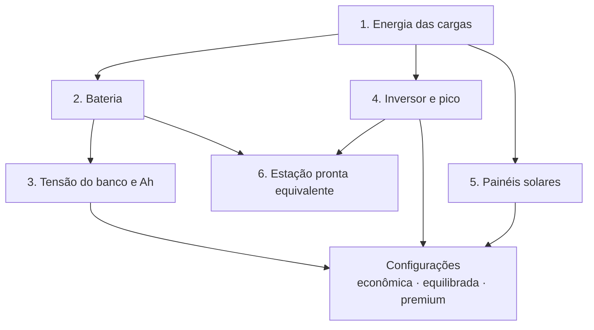

# Motor de cálculo

O motor é a parte que transforma "o que precisa ficar ligado" em números de engenharia. Ele é um módulo independente: não depende da tela, do banco de dados nem da internet, e roda **igual** no navegador (para a prévia instantânea) e no servidor (para o cálculo oficial do relatório).

## Dois conceitos que todo o resto usa

**Potência (W)** é a força com que um aparelho puxa energia *agora*. Ela define o **inversor**.
**Energia (Wh ou kWh)** é quanto o aparelho gasta *ao longo do tempo*. Ela define a **bateria**.

> **Analogia da caixa d'água.** A bateria é o tamanho da caixa (kWh). O inversor é a grossura do cano (W). O painel solar é a chuva que enche a caixa de novo (Wp). Errar qualquer um dos três deixa a casa no escuro.

## As seis etapas do cálculo

### 1. Energia das cargas

Para cada aparelho:

`Energia (Wh) = Potência (W) × Quantidade × Horas de uso × Ciclo de trabalho`

- O **ciclo de trabalho** existe porque compressores (geladeira, freezer) ligam e desligam. Uma geladeira de 150 W não consome 150 W o dia inteiro; em média, cerca de 40% do tempo.
- Se a pessoa informa o **consumo medido** (da etiqueta Inmetro ou de um medidor), esse valor **substitui** a estimativa — e o ciclo não é aplicado de novo.
- O consumo em espera (**standby**) é somado nas horas em que o aparelho não está em uso.
- **Apagão menor que 24 h:** o motor assume, de forma conservadora, que o uso diário acontece dentro do apagão. **24 h ou mais:** consumo diário × número de dias.

### 2. Bateria

Nenhuma bateria deve ser esvaziada até zero, e toda conversão perde energia. Por isso a bateria comprada é sempre maior que o consumo:

`Bateria nominal = (Energia AC ÷ eficiência do inversor + Energia DC ÷ eficiência DC) ÷ profundidade de descarga × (1 + reserva de envelhecimento)`

| Fator | Valor padrão | Por quê |
|---|---|---|
| Eficiência do inversor | 90% | Converter DC em AC perde energia em calor. |
| Eficiência do caminho DC | 95% | Cargas DC (12 V, USB) passam por conversores mais simples. |
| Profundidade de descarga — LiFePO4 | 90% | Lítio ferro-fosfato tolera descargas profundas. |
| Profundidade de descarga — chumbo-ácido | 50% | Descargas profundas encurtam muito a vida útil. |
| Reserva de envelhecimento | +10% | Baterias perdem capacidade com os anos. |

Os caminhos AC e DC são calculados **separadamente**, para que nenhuma perda seja contada duas vezes.

### 3. Tensão do banco e amperes-hora

`Ah = Wh ÷ Tensão`

Bancos maiores sobem a tensão (12 → 24 → 48 V) para reduzir a corrente — o que permite cabos mais finos e menos aquecimento. A regra usada: a menor tensão que mantém a corrente contínua até 150 A, com 12 V limitado a cerca de 2,5 kWh e 24 V a cerca de 6 kWh.

O motor também verifica, para cada modelo de bateria, os **limites do fabricante**: quantas em série e em paralelo, e a corrente contínua e de pico suportada pelo **BMS** (o circuito de proteção da bateria).

### 4. Inversor e pico de partida

Não basta somar os watts. O motor avalia:

- **Potência simultânea** — o que funciona junto. Aparelhos marcados como "não liga junto" (um micro-ondas, por exemplo) são avaliados sozinhos, somados às cargas que nunca desligam.
- **Potência aparente (VA)** — considera o fator de potência dos motores (0,8 quando o fabricante não informa).
- **Margem de 25%** — um inversor não deve trabalhar no limite.
- **Pico de partida** — motores puxam de 3 a 7 vezes a potência por um instante ao ligar. O pico considerado é a carga em operação mais a maior partida isolada.
- **Forma de onda** — sempre **senoidal pura**, exigida por motores e eletrônicos sensíveis.
- **Tensão e frequência de saída** — precisam bater com as da casa.

### 5. Painéis solares

`Potência dos painéis (Wp) = Energia diária retirada da bateria ÷ (Horas de sol pleno × Fator de desempenho × Fator do local × Eficiência de carga)`

| Fator | Valor padrão | Significado |
|---|---|---|
| Horas de sol pleno (HSP) | Por região, média anual e pior mês | Quantas horas de sol "forte" o local recebe. **Estimativa regional**, não medição do endereço. |
| Fator de desempenho | 75% | Calor, sujeira, cabos e controlador. |
| Fator do local | 100% | Orientação e sombreamento (ajustável). |
| Eficiência de carga | 95% (LiFePO4) | Perda ao guardar energia na bateria. |

Antes de sugerir qualquer arranjo de painéis, o motor valida o **controlador de carga (MPPT)**:

- a **tensão no frio** (Voc corrigido para a temperatura mínima da região) não pode passar do limite do controlador;
- a **tensão no calor** (Vmp corrigido para a célula quente) precisa ser alta o bastante para carregar a bateria;
- a **corrente de curto-circuito**, a **tensão da bateria**, a **química** e a **potência máxima** precisam estar dentro do que o controlador aceita.

Um arranjo com qualquer regra **incompatível** nunca é sugerido.

### 6. Estação pronta equivalente

Para estações de energia, o motor **nunca** assume que toda a capacidade nominal chega à tomada. Usa a energia utilizável documentada pelo fabricante ou, na falta dela, uma estimativa de **85%**, marcada como estimativa. Depois confere potência contínua (com 10% de folga), pico, tensão, frequência e entrada solar. Se a estação aceita baterias extras, o motor calcula quantas seriam necessárias.

## Resultado de compatibilidade

Cada verificação devolve um de quatro estados:

| Estado | Significado |
|---|---|
| **Compatível** | Atende, com os dados disponíveis. |
| **Compatível com condições** | Atende, mas exige um cuidado (ex.: escolher a versão de 127 V). |
| **Incompatível** | Não atende. A configuração é descartada. |
| **Dados insuficientes** | Falta um dado do fabricante. **Nunca** é tratado como compatível. |

O estado de uma configuração é o **pior** entre todas as suas verificações.

## Três configurações e recomendações

Para cada projeto, o motor monta:

| Configuração | Características |
|---|---|
| **Econômica** | Menor custo entre as opções seguras. |
| **Equilibrada** | +10% de capacidade e boa relação custo × expansão. |
| **Premium** | +25% de capacidade, inversor um tamanho acima e painéis dimensionados para o **pior mês**. |

Ele também gera **recomendações** — por exemplo, reduzir o uso do aparelho que domina o consumo ou adicionar painéis numa autonomia longa. Cada recomendação é **recalculada do zero** e mostra a configuração atual, a proposta, a diferença de custo, a diferença de desempenho e as limitações.

## O que cada cálculo registra

Todo resultado traz: as entradas, os valores, as **premissas** (e se vieram do usuário, de um datasheet ou de uma estimativa), os alertas, a **versão do motor** e a **versão das regras regionais**. Isso permite reproduzir e auditar qualquer relatório.

Veja tudo isso aplicado num caso real em [Exemplo resolvido](#pt-worked-example).
