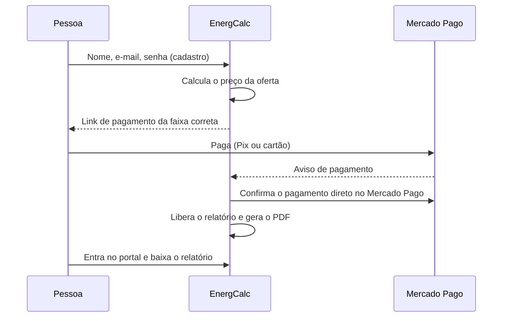

# Compra, oferta e acesso

## A oferta por tempo limitado

Quando a pessoa vê o **primeiro resultado**, começa a contar uma oferta de lançamento com descontos que diminuem em etapas de 30 minutos. Depois disso, vale o **preço normal** — e ele é de fato cobrado.

Três regras deixam a oferta justa e verdadeira:

1. **O preço é decidido pelo servidor.** O valor exibido na tela é só informação; a cobrança usa o cálculo do servidor.
2. **O tempo é por pessoa, não por aparelho.** Trocar de navegador, aparelho ou rede não reinicia a contagem. Se o e-mail informado no cadastro já tinha uma oferta em andamento, o preço correto aparece **antes** do pagamento.
3. **Última chance, uma vez só.** Quem volta depois que a oferta acabou recebe o maior desconto de volta por 15 minutos — **uma única vez**.

Todos os textos da oferta informam essas condições na própria tela.

## O pagamento

- O pagamento acontece **no Mercado Pago**. O EnergCalc nunca vê dados de cartão.
- O relatório só é liberado depois que o servidor **confirma o pagamento diretamente com o Mercado Pago** — nunca porque o navegador "disse" que pagou.
- Se um pagamento chega e não é possível associá-lo automaticamente a um cadastro (por exemplo, pago com outro e-mail), ele fica separado para o proprietário vincular manualmente.
- Há **direito de arrependimento de 7 dias**, como manda o Código de Defesa do Consumidor.

## O portal do comprador

- **Conta com e-mail e senha**, criada no próprio checkout (mínimo de 8 caracteres).
- **Confirmação de e-mail obrigatória** antes do primeiro acesso. Isso garante que só quem é dono do e-mail da compra acessa o relatório.
- **Esqueci a senha:** link enviado por e-mail para criar uma nova.
- No portal: lista de compras, relatório na tela, PDF e avaliação da compra.

## Avaliações

Só quem tem uma compra confirmada consegue avaliar. A avaliação é publicada depois de revisada, apenas com o primeiro nome e o selo **"Compra verificada"**. O EnergCalc não publica avaliações que não venham de compras reais.
