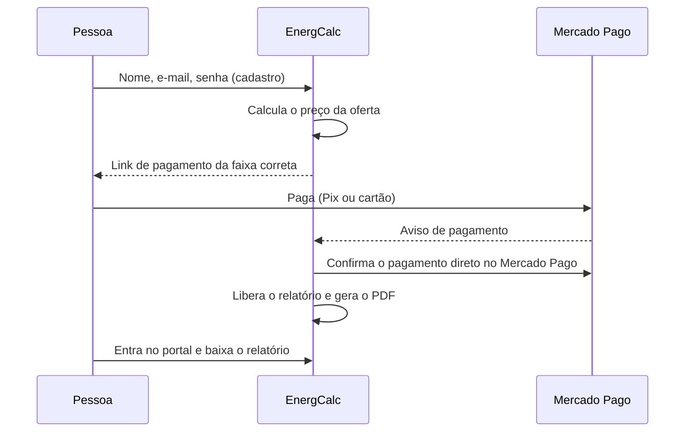

# Compra e acesso

## Oferta de boas-vindas

Para quem está conhecendo o EnergCalc, separamos uma **oferta especial de boas-vindas** no relatório completo. O desconto aparece junto do resultado, com o valor final já calculado. O preço cobrado é sempre o que está na tela no momento da compra.

## O pagamento

- O pagamento acontece **no Mercado Pago**. O EnergCalc nunca vê dados de cartão.
- O relatório só é liberado depois que o servidor **confirma o pagamento diretamente com o Mercado Pago** — nunca porque o navegador "disse" que pagou.
- Se um pagamento chega e não é possível associá-lo automaticamente a um cadastro (por exemplo, pago com outro e-mail), ele fica separado para o proprietário vincular manualmente.
- Há **direito de arrependimento de 7 dias**, como manda o Código de Defesa do Consumidor.

## O portal do comprador

- **Conta com e-mail e senha**, criada no próprio checkout (mínimo de 8 caracteres).
- **Confirmação de e-mail obrigatória** antes do primeiro acesso. Isso garante que só quem é dono do e-mail da compra acessa o relatório.
- **Esqueci a senha:** link enviado por e-mail para criar uma nova.
- No portal: lista de compras, relatório na tela, PDF e avaliação da compra.

## Avaliações

Só quem tem uma compra confirmada consegue avaliar. A avaliação é publicada depois de revisada, apenas com o primeiro nome e o selo **"Compra verificada"**. O EnergCalc não publica avaliações que não venham de compras reais.
