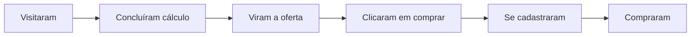

# Painel do proprietário

O painel mostra como o site está sendo usado e vendido. O acesso é restrito: a permissão de administrador é verificada no banco de dados, não apenas escondendo a tela.

## Abas

| Aba | Para que serve |
|---|---|
| **Visão geral** | Indicadores, funil, gráfico diário, origens, páginas, cliques por estação, aparelhos. |
| **Rastreio** | A jornada de cada visita, evento por evento. |
| **Cadastros** | Quem se cadastrou, origem, status da compra, contato por WhatsApp e exportação em planilha. |
| **Compras** | Pedidos pagos, valores, faixa da oferta, estorno. |
| **Pagamentos sem vínculo** | Pagamentos que precisam ser associados manualmente a um cadastro. |
| **Avaliações** | Moderação e cor da inicial de cada avaliação. |
| **Links de pagamento** | Um link do Mercado Pago para cada faixa de preço. |
| **Catálogo** | Preço com fonte e data, status de verificação e link de indicação de cada produto. |

## Dicionário de métricas

| Métrica | Como é contada |
|---|---|
| **Visitantes** | Identificadores anônimos únicos que abriram ao menos uma página no período. |
| **Sessões** | Visitas; uma sessão termina após 30 minutos sem atividade. |
| **Visualizações** | Total de páginas abertas. |
| **Usaram a calculadora** | Sessões que mexeram na calculadora rápida. |
| **Cálculos concluídos** | Resultados gerados (rápida ou completa). |
| **Cliques afiliado** | Cliques nos links de compra de estações. |
| **Viram a oferta** | Sessões em que o quadro do relatório apareceu na tela. |
| **Clicaram em comprar** | Sessões que abriram o formulário de compra. |
| **Cadastros** | Pessoas que enviaram nome e e-mail no checkout. |
| **Compras** | Pedidos com pagamento confirmado no período. |
| **Receita** | Soma dos pedidos confirmados. |
| **Conversão** | Compras ÷ visitantes. |
| **Ticket médio** | Receita ÷ compras. |

## O funil

Cada etapa mostra o número de sessões e a porcentagem em relação à etapa anterior — o lugar com a maior queda é onde vale a pena melhorar primeiro.

## Origem das visitas

A origem vem do parâmetro `utm_source` do link (por exemplo, `?utm_source=instagram&utm_medium=bio`) ou, na falta dele, do site que enviou a visita. Sem nenhum dos dois, aparece como **direto**. A origem do **primeiro acesso** fica associada à pessoa, para que uma compra feita dias depois ainda seja atribuída ao canal certo.
