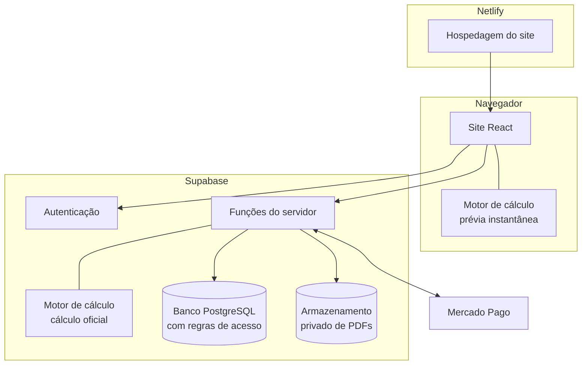

# Arquitetura

O EnergCalc é uma aplicação web com três camadas: o **site** (no navegador), o **servidor** (banco de dados e funções) e o **provedor de pagamento**.

## Componentes

| Componente | Tecnologia | Responsabilidade |
|---|---|---|
| Site | React, TypeScript, Vite, Tailwind CSS | Telas, calculadoras, portal e painel. |
| Hospedagem | Netlify | Publicação do site e versões de prévia. |
| Motor de cálculo | Pacote TypeScript independente | Todas as contas de engenharia. |
| Banco de dados | PostgreSQL (Supabase) | Projetos, cálculos, pedidos, catálogo, métricas. |
| Autenticação | Supabase Auth | Sessões anônimas na calculadora; e-mail e senha no portal. |
| Funções do servidor | Supabase Edge Functions | Cálculo oficial, preço, pagamento, relatório, administração. |
| Armazenamento | Supabase Storage | PDFs privados. |
| Pagamento | Mercado Pago | Pix e cartão. |

## Decisões de projeto

**Um motor, dois lugares.** O mesmo código de cálculo roda no navegador (resposta instantânea enquanto a pessoa mexe nos botões) e no servidor (o resultado oficial que vai para o relatório). Assim, a prévia e o relatório nunca discordam.

**Uma fonte para cada regra.** O preço da oferta, os textos dos resultados e o modelo do relatório existem em um único lugar, usado tanto pela tela quanto pelo servidor.

**O navegador nunca decide o que vale dinheiro.** Preço, liberação do relatório e cálculo oficial são sempre definidos no servidor.

**Tela e PDF a partir do mesmo modelo.** O relatório é montado uma vez como dados estruturados e depois desenhado de dois jeitos: em HTML no portal e em PDF no servidor.

**Calculadora sem cadastro.** A pessoa calcula com uma sessão anônima; a conta com e-mail e senha só é criada na compra.

## Funções do servidor

| Função | O que faz |
|---|---|
| Cálculo oficial | Executa o motor com o catálogo do banco e grava o resultado imutável. |
| Oferta | Informa a oferta de boas-vindas válida para a pessoa. |
| Início da compra | Registra o cadastro, calcula o preço e devolve o link de pagamento. |
| Aviso de pagamento | Recebe o aviso do Mercado Pago, confirma o pagamento e libera o relatório. |
| Relatório | Entrega o relatório para a tela e um link temporário para o PDF. |
| Pedidos (admin) | Liberação manual, estorno e vínculo de pagamentos. |
| Catálogo (admin) | Preços com fonte, verificação e links de indicação. |

## Idiomas e regiões

Todo texto da interface fica em arquivos de tradução (português e inglês). As regras técnicas por país ficam em **perfis de jurisdição versionados**: hoje o Brasil (60 Hz, tomadas de 127 ou 220 V, cinco regiões climáticas). A estrutura já prevê outros países, que só serão ativados depois de revisão profissional das regras locais.
